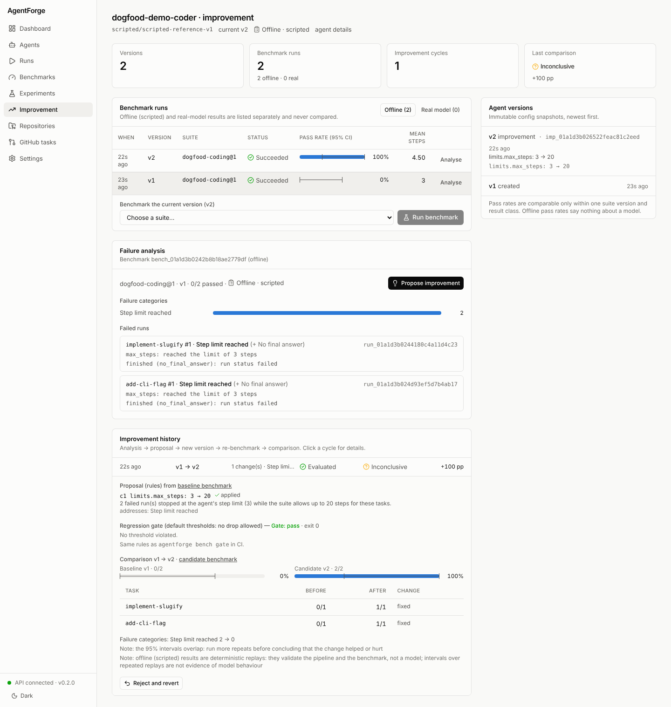

# Five-minute tour (offline)

This tour walks the whole AgentForge loop on your machine — **benchmark →
failure analysis → improvement proposal → new agent version → re-benchmark →
comparison → CI regression gate** — with no API key, no model calls and no
network access.

```bash
uv sync --all-extras
uv run python scripts/tour.py              # runs every step below in a temporary data directory
uv run python scripts/tour.py --keep .tour # keeps the database so the dashboard can show it
```

`scripts/tour.py` runs exactly the commands shown here and checks each exit
code; it exits non-zero if any step behaves differently from this page
(`tests/e2e/test_tour.py` runs it in CI, so this page cannot silently go out of
date).

> **These are OFFLINE results.** The agents use the *scripted* provider, which
> replays fixed reference solutions. They demonstrate the pipeline and the
> benchmark checks; they say nothing about any model. Real-model results are
> kept separately — see [REAL_MODEL_BENCHMARK.md](REAL_MODEL_BENCHMARK.md).

The output below is a real transcript of `scripts/tour.py` (2026-11-11); run
ids, agent ids and timestamps differ on every run. To type the commands
yourself, set `AGENTFORGE_DATA_DIR` to an empty directory first and run them
from the repository root with `uv run`.

## The setup

| File | Role |
|---|---|
| `dogfood/benchmarks/coding.yaml` | Suite `dogfood-coding` v1: two small coding tasks with visible tests, hidden checks and process checks |
| `dogfood/agents/offline/demo-coder-v1.yaml` | Agent `dogfood-demo-coder`: correct scripted solutions, but `limits.max_steps: 3` — too few for the tasks |
| `examples/ci/baselines/dogfood-coding-offline.json` | The accepted baseline report that the example CI workflow gates against |

## 1. Benchmark a versioned agent

```console
$ agentforge bench run dogfood/benchmarks/coding.yaml -a dogfood/agents/offline/demo-coder-v1.yaml --save-agent --json
```

`--save-agent` stores the config as an immutable agent version (v1) and links
the benchmark to it. Both tasks fail: the agent runs out of steps. (`--json`
prints the full report; without it you get a table.)

## 2. Analyse the failures

```console
$ agentforge improve analyze bench_01a1c95f7e150987de886ef2
benchmark bench_01a1c95f7e150987de886ef2  suite=dogfood-coding@1  agent=dogfood-demo-coder v1  results=OFFLINE
runs 2  passed 0  failed 2
failure categories:
  step_limit             2
- implement-slugify #1 [step_limit] run_01a1c95f7e269adea9008eec
    max_steps: reached the limit of 3 steps
    finished (no_final_answer): run status failed
- add-cli-flag #1 [step_limit] run_01a1c95f7ea1b66c1815591d
    max_steps: reached the limit of 3 steps
    finished (no_final_answer): run status failed
```

Every failed run is classified from its stored record — stop reason, evaluator
results, tool calls — and the evidence is listed with it
([categories](improvement.md#failure-categories)).

## 3. Propose, apply and re-evaluate

```console
$ agentforge improve run bench_01a1c95f7e150987de886ef2 --cycles 1
improvement imp_01a1c95f7f9f17bc06a44679  agent=dogfood-demo-coder v1 -> v2  status=evaluated  results=OFFLINE
proposal (rules):
 *c1  limits.max_steps set 20
       why: 2 failed run(s) stopped at the agent's step limit (3) while the suite allows up to 20 steps for these tasks.
comparison (dogfood-coding@1):
  baseline  dogfood-demo-coder v1        pass 0/2 (0%, 95% CI 0.00-0.66)  steps 3.0
  candidate dogfood-demo-coder v2        pass 2/2 (100%, 95% CI 0.34-1.00)  steps 4.5
  verdict: INCONCLUSIVE  (pass rate +100%)
  implement-slugify            fixed     0/1 -> 1/1
  add-cli-flag                 fixed     0/1 -> 1/1
  note: the 95% intervals overlap: run more repeats before concluding that the change helped or hurt
  note: offline (scripted) results are deterministic replays: they validate the pipeline and the benchmark, not a model; intervals over repeated replays are not evidence of model behaviour
```

One cycle: the rule-based proposer maps `step_limit` to a change of an
allowlisted path (never credentials, endpoints, the sandbox or the approval
policy), capped by the suite's own limit. The change is applied as **v2**,
benchmarked on v1's exact suite snapshot and compared with Wilson 95%
intervals. The verdict is honest about the sample: one run per task is
`INCONCLUSIVE`, even though both tasks flipped from failing to passing. Use
`-r/--repeats` on real-model benchmarks before drawing conclusions.

The steps can also be run one at a time — `improve propose`, `improve apply`,
`improve evaluate`, `improve reject` — or with a hand-written proposal; see
[improvement.md](improvement.md).

## 4. Inspect the history

```console
$ agentforge improve history dogfood-demo-coder
agent dogfood-demo-coder (agt_01a1c95f7e0f671c4ce456bc) current v2
versions:
  v2   2026-11-11 06:50  improvement limits.max_steps: 3 -> 20
  v1   2026-11-11 06:50  created
benchmarks:
  bench_01a1c95f7fb1e0a1eacfe961  2026-11-11 06:50  v2   dogfood-coding@1  offline succeeded pass 100%
  bench_01a1c95f7e150987de886ef2  2026-11-11 06:50  v1   dogfood-coding@1  offline succeeded pass 0%
improvements:
  imp_01a1c95f7f9f17bc06a44679  2026-11-11 06:50  v1 -> v2   evaluated  inconclusive
```

Nothing is overwritten: the versions, both benchmarks, the analysis, the
proposal and the comparison are all stored, so the change can be traced from
the failure that motivated it to the benchmark that confirmed it.

## 5. Gate the change (v1 → v2): exit 0

```console
$ agentforge bench gate --baseline bench_01a1c95f7e150987de886ef2 --candidate bench_01a1c95f7fb1e0a1eacfe961
REGRESSION GATE: PASS (exit 0)
suite dogfood-coding@1  results offline
baseline  bench_01a1c95f7e150987de886ef2  dogfood-demo-coder v1  scripted/scripted-reference-v1  pass 0/2 (0.0000)  mean score 0.7750
candidate bench_01a1c95f7fb1e0a1eacfe961  dogfood-demo-coder v2  scripted/scripted-reference-v1  pass 2/2 (1.0000)  mean score 1.0000
thresholds: max pass-rate drop 0.0000, max task pass-rate drop 0.0000, max mean-score drop 0.0000, min pass rate none
tasks:
  add-cli-flag                     0/1 -> 1/1  (+1.0000)
  implement-slugify                0/1 -> 1/1  (+1.0000)
```

## 6. Gate a regression (v2 → v1): exit 1

Swapping baseline and candidate shows what a regressing change looks like:

```console
$ agentforge bench gate --baseline bench_01a1c95f7fb1e0a1eacfe961 --candidate bench_01a1c95f7e150987de886ef2
REGRESSION GATE: REGRESSION (exit 1)
...
regressions:
  - pass rate dropped by 1.0000 (1.0000 -> 0.0000; allowed 0.0000)
  - task add-cli-flag: pass rate dropped by 1.0000 (1/1 -> 0/1; allowed 0.0000)
  - task implement-slugify: pass rate dropped by 1.0000 (1/1 -> 0/1; allowed 0.0000)
  - mean score dropped by 0.2250 (1.0000 -> 0.7750; allowed 0.0000)
```

## 7. Gate against the committed CI baseline: exit 1

In CI the baseline is a committed report file, not a run in the job's database:

```console
$ agentforge bench gate --baseline examples/ci/baselines/dogfood-coding-offline.json --candidate bench_01a1c95f7e150987de886ef2
REGRESSION GATE: REGRESSION (exit 1)
suite dogfood-coding@1  results offline
baseline  bench_01a0e23b0177d678d0b9c8c2  dogfood-coding-offline  scripted/scripted-reference-v1  pass 2/2 (1.0000)  mean score 1.0000
candidate bench_01a1c95f7e150987de886ef2  dogfood-demo-coder v1  scripted/scripted-reference-v1  pass 0/2 (0.0000)  mean score 0.7750
...
```

A failing gate (exit 1) or an undecidable one (exit 2: different suite,
offline vs real results, missing baseline, infrastructure failure) fails the
CI job; an error is never a pass.
[`.github/workflows/agentforge-regression.yml`](../.github/workflows/agentforge-regression.yml)
is the working example, and [regression-gate.md](regression-gate.md) documents
the thresholds.

## See it in the dashboard

```bash
uv run python scripts/tour.py --keep .tour
AGENTFORGE_DATA_DIR=.tour uv run agentforge serve   # API on :8000
cd web && npm ci && npm run dev                     # dashboard on :3000
```

Open <http://localhost:3000/improvement>: the agent's versions with the config
diff, both benchmarks (listed under *offline*), the failure categories with
evidence and the evaluated cycle with its gate verdict.



## Where to go next

- A real model: [README → Quick start](../README.md#quick-start-offline-no-api-key)
  (needs a provider key; the example agents run tools in the Docker sandbox).
- Human approval before sensitive tool calls: `approval.require_for` in the
  agent config ([README → Creating an agent](../README.md#creating-an-agent)).
- The other dogfooding suites and agents: [dogfood/README.md](../dogfood/README.md)
  and `uv run python scripts/dogfood.py offline`.
